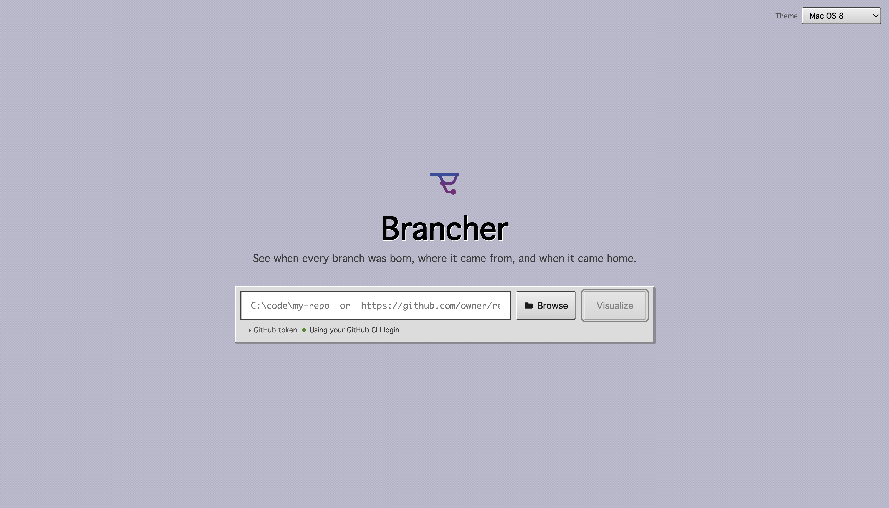
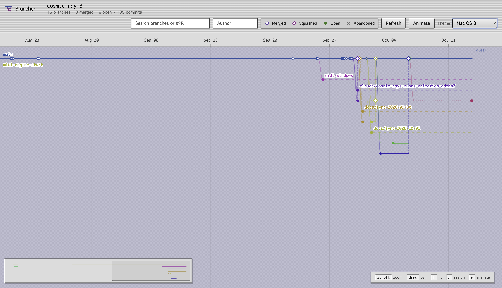
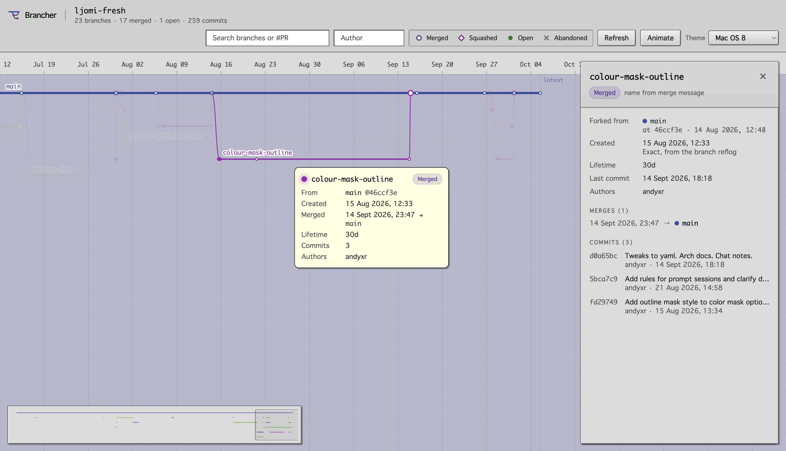

# Brancher


A temporal view of git branches: when each branch was created, which branch it came from, and when it was merged back, on a zoomable timeline.

## Quick start

Requires Node.js 22.12 or newer and Git on your PATH.

```sh
npm install
npm run dev        # API on 127.0.0.1:4310, UI on http://localhost:5173
```

To try it without a repo of your own, build a sample and open that folder in the UI:

```sh
npm run demo       # writes ~/.brancher/demo-repo
```

The UI calls the API directly (set `VITE_API_URL` to point elsewhere); the API only accepts browser requests from localhost origins.

Open the UI and enter a local path (`C:\code\my-repo`, or click **Browse** to pick a folder; git repos are badged) or a clone URL (`https://github.com/expressjs/express`). Remote repos are cloned bare and treeless into `~/.brancher/cache` (override with `BRANCHER_CACHE`).

For GitHub repos, pull request data is fetched to name branches, link PRs and recover squash/rebase merges; private repos need a token. The server looks for one in this order:

1. a token pasted in the UI (memory only, until the server restarts)
2. a token saved with **Remember on this computer**, kept encrypted in the OS credential store (Windows Credential Manager / macOS Keychain / Secret Service)
3. the `GITHUB_TOKEN` environment variable
4. your GitHub CLI login (`gh auth token`)

The token never reaches the browser; the UI only shows which source is in use, with a **forget** link for saved tokens. Without any token only ~500 recent PRs of public repos are read (60 requests/hour limit).

## Using the timeline



Each branch is a lane. It starts at its fork point, runs through its commits, and ends at a merge into another branch. The trunk is the default branch.

### Zoom and pan

- **Zoom.** Scroll the wheel (or pinch on a trackpad) to zoom the time axis around the cursor. `+` / `-` zoom around the center of the view.
- **Pan.** Drag, swipe sideways, or use the arrow keys. Shift+scroll scrolls through lanes when they don't all fit.
- **Fit to screen.** Press `f` to reset to the whole history. Fit is the minimum zoom, so you can't scroll past either end.
- **Minimap.** The overview strip at the bottom shows the whole history and your current window. Click or drag it to move the main view.
- **Axis ticks.** Ticks refine as you zoom.

### Finding branches

- `/` focuses search. Enter / shift+Enter cycles through matches, zooming to each one.
- Filter by author, or toggle the legend entries (merged, squashed, open, abandoned) to hide or show branch states.
- Click a branch to select it and open the side panel: its dates and where they came from, merges, child branches and commits. Esc deselects.



### Animate mode

Replays the repo's history from the first event to the last. Press `a` or click **Animate** to start; Esc, `a` or ✕ exits.

- **Play / pause.** Press space or click ▶. ⏮ jumps back to the start.
- **Scrub.** Drag the slider to any point in history. The date shows the playhead time.
- **Speed.** Choose 0.5×, 1×, 2× or 4×. 1× replays the whole history in about 30 seconds.
- **Idle gaps.** Busy stretches play in real proportion, and long quiet periods pass in a short beat.
- **Follow.** The camera tracks the playhead, keeping it in view as you zoom. Panning by hand turns Follow off. Click **Follow** to turn it back on.
- Branches, commits and merges appear as the playhead reaches them, with a brief flash. If your OS requests reduced motion, the flash is off.
- **Loop.** Click **Loop** to replay from the start each time playback reaches the end.
- At the end, without Loop, the playhead returns to the start and pauses. Press play to run it again, or exit animate to see the full static view.

#### 3D time tunnel

Press `3` or click **3D** to replay the history in 3D. Time runs along the tunnel, the trunk is its central axis, and each branch sits around it at a distance set by its depth. The camera rides just ahead of the playhead and looks back down the tunnel, so recent history is close and older history fades into the distance. Quiet periods are compressed in space as well as time, so the camera moves at a steady speed.

- **Switch.** Use the 2D / 3D toggle on the playback bar, or press `a` (2D) or `3` (3D). The playhead, speed, loop and selection carry over, and Follow turns back on.
- **Orbit.** Drag to orbit and scroll to zoom. Follow stays on.
- **Pan.** Right-drag or shift-drag. Panning turns Follow off. Click **Follow**, or press `r`, to get back on the axis.
- **Inspect.** Hover or click a branch or commit to highlight the branch and open its details panel.
- **Labels.** Only the trunk, the focused branch and the branches active near the playhead are labelled.

### Shortcuts

| Key | Action |
| --- | --- |
| scroll | zoom |
| shift+scroll | scroll lanes |
| drag | pan |
| arrows | pan |
| `+` / `-` | zoom in / out |
| `f` | fit whole history |
| `/` | search |
| Enter / shift+Enter | next / previous match |
| `a` | toggle 2D animate mode (switches from 3D to 2D) |
| `3` | toggle 3D animate mode (switches from 2D to 3D) |
| `r` | re-follow the playhead (3D) |
| space | play / pause (animate) |
| Esc | exit animate, or deselect |

### Themes

Use the **Theme** dropdown to switch UI themes (Pigment, Mac OS 8, Mac OS 8 Mono).

## How branch history is reconstructed

Git doesn't record when branches are created or merged, so Brancher infers it from the commit graph (`packages/core/src/infer/inferTimeline.ts`):

1. The default branch claims its first-parent chain as the trunk.
2. Merge commits are processed oldest first. Each merged-in parent claims its first-parent chain until it reaches an already-claimed commit. That commit is the fork point, and its owner is the parent branch. This is how branches nest.
3. Names come from merge messages (git, GitHub, GitLab, Bitbucket, Azure formats), then live refs. `git pull` merges show as `name (pull)`.
4. Remaining live refs become open (or, after 90 idle days, abandoned) branches.
5. Creation time is exact when the local reflog has `branch: Created from`; otherwise it's the first commit's author time (shown as `≈`, with a dotted segment back to the fork point).
6. GitHub PRs fill in names and links and add squash-merged branches.

### Known limits

- Fast-forward merges leave no trace without PR data.
- Rebased branches show post-rebase commit times.
- When two unmerged branches share commits, which one is the parent is a guess (reflog creation order is used when available).

## Layout

```
packages/core    git extraction + inference (pure TS, tested with real fixture repos)
packages/server  Fastify API: repo resolution, clone cache, GitHub enrichment
packages/web     React + D3 timeline UI, three.js (react-three-fiber) 3D tunnel
```

`npm test` runs the core and web tests (including the 3D layout); `npm run typecheck` checks all packages.
